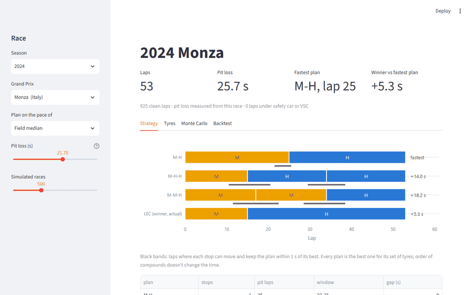
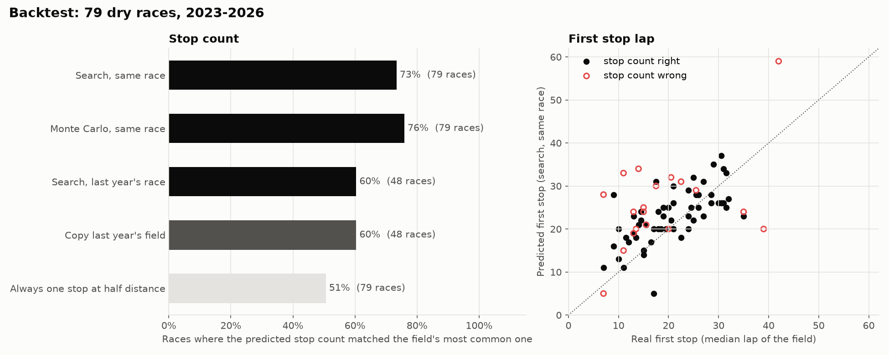
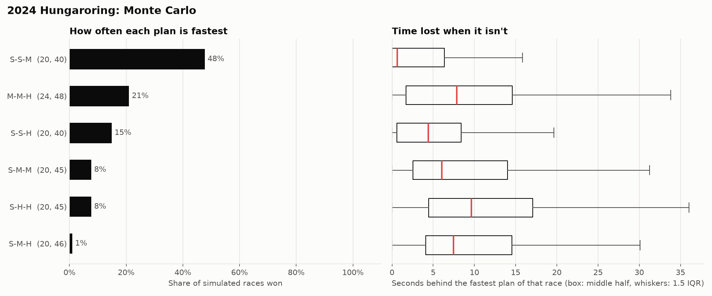

# f1-pit-strategy

Pick a Formula 1 race and this tool fits a tyre model to every green-flag lap, measures what a pit stop cost at that track, and searches all one- and two-stop plans for the fastest one. A Monte Carlo run then checks how often that plan still wins once safety cars and an uncertain tyre fit are thrown in. I ran the whole thing over every race from 2023 to 2026 and compared it with what the teams actually did.



Data comes from [OpenF1](https://openf1.org), which is free and needs no account. I started on FastF1, but the F1 live timing feed behind it now answers `401` without an F1 login, so it was a dead end for a tool anyone can run.

## Results

Over 79 dry races (2023 to 2026 so far), this is how often each predictor got the field's stop count right and how close it came to the lap of their first stop:

| predictor | races | stop count right | first stop, mean error | first stop within 3 laps |
|---|---|---|---|---|
| Monte Carlo, same race | 79 | **76%** | 6.2 laps | 32% |
| search, same race | 79 | 73% | **6.2 laps** | 32% |
| search, fitted on last year's race | 48 | 60% | 7.5 laps | 23% |
| copy last year's field | 48 | 60% | 7.6 laps | **30%** |
| always one stop at half distance | 79 | 51% | 10.5 laps | 17% |



What I take from it:

- **The Monte Carlo is a little better at the stop count.** It disagreed with the plain search on 6 races and was right in 4 of them (Singapore and Abu Dhabi 2023, Hungary 2025 and 2026). On the lap of the first stop the two are level.
- **The model stops too late.** In the 58 races where the stop count matched, its first stop came 2.2 laps after the field's on average, and later in 66% of them. That's the undercut: on an empty track the tyre maths says stay out, but in a real race the car behind pits first and takes the position. The model has no other cars in it.
- **It leans to one stop.** Of 21 misses, 13 are "one stop" where the field did two. The other way round happened 3 times.
- **Fitting last year's race doesn't beat copying last year's strategy** (29 of 48 right each). Tyre allocations and cars change between seasons, and a model fitted on last year's laps carries that over.

The 12 races not counted were either not held (Imola 2023; Sakhir and Jeddah 2026) or had too few dry finishers to call a field strategy (wet races like Monaco 2023, Silverstone 2024 and Spa 2025). The full table, per-year numbers and the misses are in [docs/validation.md](docs/validation.md).

## Run it

```bash
git clone https://github.com/RizgarOzan/f1-pit-strategy
cd f1-pit-strategy
pip install -e ".[dev,app]"

f1strat plan 2024 Monza --plot monza.png
f1strat simulate 2024 Hungary
streamlit run app/dashboard.py
```

`plan` fits the model and ranks the plans:

```
2024 Monza: 53 laps, 925 clean laps, planning on field median pace
Pit loss 25.7 s (measured from this race)
  MEDIUM  +0.00 s vs medium,  +0.033 s/lap wear,  longest clean stint 20 laps
  HARD    -0.35 s vs medium,  +0.047 s/lap wear,  longest clean stint 42 laps
  fuel    -0.060 s/lap as the car gets lighter

 #  plan     stops  pit lap    window (within 1 s)       gap
 1  M-H          1  25         22-25                 fastest
 2  M-H-H        2  15, 34     11-20, 30-38          +14.0 s
 3  M-M-H        2  17, 34     12-22, 29-38          +18.2 s

Winner LEC ran M1-15 H16-53: +5.3 s vs the best plan on the same pace.
```

Leclerc's Monza win shows what that last line means. The model says pitting on lap 15 and running 38 laps on hards cost him about 5 seconds against a lap-25 stop. Ferrari did it anyway because the one-stop kept him ahead of the McLarens, who stopped twice. Track position isn't in this model, and that 5 s is roughly what Ferrari paid for it.

The race argument takes a location, circuit or country (`Monza`, `Sakhir`, `Spain`). `--driver VER` plans around one driver's pace instead of the field median, `--pit-loss 21` overrides the measured stop cost, and `--evaluate` compares the lap model with gradient boosting on that race. The first run downloads under 1 MB per race into `.cache/`; after that it works offline. `f1strat fetch 2025` caches a whole season and `f1strat backtest 2023 2024 2025 2026` rebuilds everything in `results/` (about 7 minutes with a warm cache).

## Monte Carlo

The search answers "what's fastest if the tyre model is exactly right and nothing happens". That's rarely the race you get. `simulate` replays the top plans through 1000 races where:

- the tyre model is refit on a bootstrap of whole stints, so a compound seen on only a few stints gets a wide spread of wear rates;
- the pit loss is drawn from the stops measured in that race;
- safety cars and VSCs arrive at the rate measured over the backtest (1.2 per race, 2.8 laps each), and a car pits under one when that saves time. A stop under neutralisation cost 66% of a green one, the median over 40 races.

Hungary 2024 is where this earns its keep:

```
1000 simulated races: refit tyre model, drawn pit loss, random safety cars
plan     pit lap      wins  mean gap  90% worst  pitted under SC
S-S-M    20, 40        48%      8.9s      42.5s             29%
M-M-H    24, 48        21%     11.0s      24.8s             25%
S-S-H    20, 40        20%     10.9s      45.0s             28%
S-M-M    20, 45         8%      9.6s      24.5s             22%
S-M-H    20, 46         3%     10.7s      23.8s             20%
```



The search puts soft-soft-medium first, but the soft fit there rests on short stints and a wear rate of only +0.019 s/lap. Once that number is allowed to move, the plan wins under half the races and its bad tail is 42 s. The medium-led plans almost never lose by much. The field went two stops, and Piastri won on medium-hard-medium.

## How it works

**Cleaning.** Lap 1, in-laps and out-laps go. So does any lap where the field's median was more than 5% slower than usual, which takes out safety cars, VSCs and red-flag restarts without needing flag data, plus single laps more than 5% off the pace.

**Lap time model.** Each clean lap is fit as

```
lap_time = driver_pace + fuel × lap_number + compound_offset + wear[compound] × tyre_age
```

with one least-squares solve over the whole field. Every number means something on a pit wall, and `driver_pace` soaks up the car so the tyre terms are shared. Fuel and wear can only be told apart because different cars run the same compound at different points of the race.

**Pit loss.** For every green-flag stop, in-lap plus out-lap minus two predicted normal laps. Stops where either lap was under a safety car are left out, otherwise a race where the field pitted under SC reports a 100 s stop. The planning number is the 40th percentile, which lands between 17 and 31 s across the backtest (median 22).

**Search.** A stint's time has a closed form under a linear model, so all of the roughly 40,000 one- and two-stop plans for a 70-lap race are scored in under a third of a second. Plans use two dry compounds, and a stint may run at most 5 laps past the longest one the data saw on that compound, because a straight line can't know where a tyre falls off.

The long version, with the backtest rules, is in [docs/methodology.md](docs/methodology.md).

## Why not gradient boosting?

The original idea was XGBoost on lap times. The backtest compares the linear model with scikit-learn's gradient boosting on every race, two ways: hold out whole stints, and train on younger tyres then predict older ones.

| test (79 races, median MAE) | this model | GBM | this model better in |
|---|---|---|---|
| held-out stints | **0.49 s** | 0.63 s | 89% of races |
| tyres older than training | 0.55 s | 0.58 s | 54% of races |

On stints it hasn't seen, the linear model wins clearly. On older tyres it's about a tie, which is less than I expected: an early six-race check had it ahead there too, and the full run didn't hold that up. I kept the linear model because it can be searched in closed form, its numbers are readable, and trees predict a flat line past the oldest tyre they've seen, so a long stint looks free to them. One race, Miami 2025, breaks the older-tyre test outright (31 s error): with only laps 25 and later held back, fuel and wear move together and can't be told apart. The fit on the full race is fine.

## What it doesn't know

- **Other cars.** No traffic, no undercut, no track position. This is the biggest gap and the backtest shows it as the 2-lap late bias.
- **Order of compounds.** Fuel is its own term, so soft-then-hard and hard-then-soft cost the same. Plans list the softest first.
- **Used tyres.** Every planned stint starts on a new set.
- **Thin compounds.** A compound with under 30 clean laps is left out (Monza 2024 had one soft lap).
- **Wet races.** Only dry compounds are modelled.

## Tests and CI

```bash
pytest
ruff check .
```

The tests build a race from known numbers and check the fit gets them back, that the closed-form stint time matches a lap-by-lap sum, that every plan covers the race within the stint limits, that a green race in the simulator costs exactly the closed form, and that a safety car inside the pit window pulls the stop forward. None of them touch the network. GitHub Actions runs both on Python 3.10 and 3.12.

## Layout

```
src/f1strat/openf1.py    download + cache, season lists, clean-lap and safety car filters
src/f1strat/model.py     lap time model, pit loss, cross-validation vs GBM
src/f1strat/strategy.py  plan search, pit windows, actual-strategy replay
src/f1strat/simulate.py  Monte Carlo with bootstrapped tyre fits and safety cars
src/f1strat/backtest.py  every race vs what the field did
src/f1strat/plot.py      static charts (matplotlib)
src/f1strat/charts.py    dashboard charts (Plotly)
src/f1strat/__main__.py  CLI: plan, simulate, backtest, fetch
app/dashboard.py         Streamlit app
results/                 backtest output the dashboard reads
docs/                    methodology, validation, charts
```

MIT licensed.
