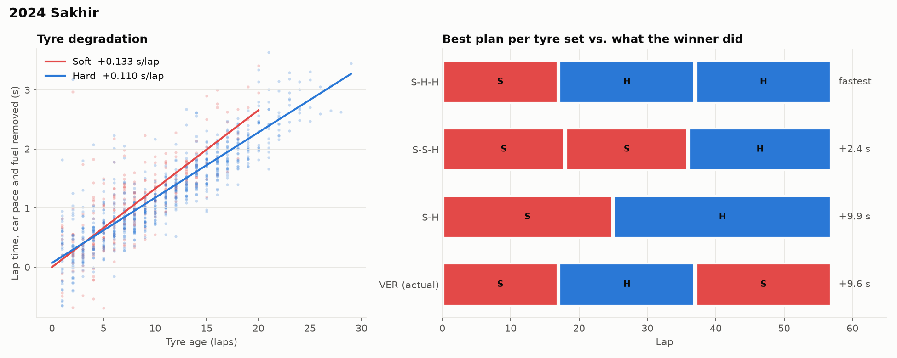

# f1-pit-strategy

Pick a Formula 1 race and this tool fits a tyre model to every green-flag lap, measures what a pit stop cost at that track, and searches all one- and two-stop plans for the fastest one. It then puts the winner's real strategy through the same model, so you can see where they followed the numbers and where they gambled.



Data comes from [OpenF1](https://openf1.org), which is free and needs no account. I started on FastF1, but the F1 live timing feed behind it now answers `401` without an F1 login, so it was a dead end for a tool anyone can run.

## Run it

```bash
git clone https://github.com/RizgarOzan/f1-pit-strategy
cd f1-pit-strategy
pip install -e ".[dev]"

python -m f1strat 2024 Monza --evaluate --plot monza.png
```

```
2024 Monza: 53 laps, 925 clean laps, planning on field median pace
Pit loss 25.7 s (measured from this race)
  MEDIUM  +0.00 s vs medium,  +0.033 s/lap wear,  longest clean stint 20 laps
  HARD    -0.35 s vs medium,  +0.047 s/lap wear,  longest clean stint 42 laps
  fuel    -0.060 s/lap as the car gets lighter

Lap-time error (MAE), this model vs gradient boosting:
  held-out stints           0.469 s  vs  0.579 s
  tyres older than 13 laps  0.650 s  vs  0.611 s

 #  plan     stops  pit lap    window (within 1 s)       gap
 1  M-H          1  25         22-31                 fastest
 2  M-H-H        2  15, 34     11-20, 30-38          +14.0 s
 3  M-M-H        2  17, 34     12-22, 29-38          +18.2 s

Winner LEC ran M1-15 H16-53: +5.3 s vs the best plan on the same pace.
```

The race argument takes a location, circuit or country name (`Monza`, `Sakhir`, `Spain`). A typo prints the list of that season's circuits. `--driver VER` plans around one driver's pace instead of the field median, and `--pit-loss 21` overrides the measured stop cost. The first run downloads under 1 MB per race into `.cache/`; after that it works offline.

Leclerc's Monza win is a good example of what the last line means. The model says pitting on lap 15 and running 38 laps on hards cost him about 5 seconds against a lap-25 stop. Ferrari did it anyway because the one-stop kept him ahead of the McLarens, who stopped twice. Track position is outside this model, and that 5 s is roughly what Ferrari paid for it.

## How it works

**Cleaning.** Lap 1, in-laps and out-laps go. So does any lap where the field's median was more than 5% slower than usual, which takes out safety cars and VSCs without needing flag data, plus individual laps more than 5% off the pace.

**Lap time model.** Each clean lap is fit as

```
lap_time = driver_pace + fuel × lap_number + compound_offset + wear[compound] × tyre_age
```

with one least-squares solve over the whole field. Every number means something on a pit wall, and `driver_pace` soaks up the car so the tyre terms are shared. Fuel and wear can only be told apart because different cars run the same compound at different points of the race. If everyone ran soft-medium-hard on the same laps, the fit couldn't separate them (the tests build exactly that case).

**Pit loss.** For every stop under green, in-lap plus out-lap minus two predicted normal laps. I take the 40th percentile so a stuck wheel nut doesn't set the plan. This lands at 20-26 s across the races below.

**Search.** A stint's time has a closed form under a linear model, so every one- and two-stop plan for a 70-lap race is scored in about 0.2 s. Plans must use two dry compounds. A stint can run at most 5 laps past the longest stint the data actually saw on that compound, because a straight line has no way of knowing where a tyre falls off a cliff. The window column is the range of laps for each stop that keeps the plan within 1 s of its best, with the other stop held fixed.

## Why not gradient boosting?

The original idea was XGBoost on lap times. I tried it against the model above on six 2023-24 races, with two tests: hold out whole stints, and train only on younger tyres then predict older ones. The second test is the one that matters, since a strategy search keeps asking "what if this stint ran 8 laps longer?"

| race | held-out stints, this / GBM | older tyres, this / GBM |
|---|---|---|
| 2024 Sakhir | **0.37** / 0.60 s | **0.34** / 0.68 s |
| 2023 Silverstone | **0.40** / 0.45 s | 0.33 / **0.31** s |
| 2024 Catalunya | **0.44** / 0.58 s | **0.51** / 0.65 s |
| 2024 Hungaroring | **0.55** / 0.59 s | **0.62** / 0.68 s |
| 2024 Spielberg | **0.34** / 0.36 s | **0.37** / 0.48 s |
| 2024 Monza | **0.47** / 0.58 s | 0.65 / **0.61** s |
| mean | **0.43** / 0.53 s | **0.47** / 0.57 s |

Trees can't extrapolate. Past the oldest tyre they trained on they predict a flat line, so a long stint looks free. I also tried adding an `age²` term to catch the fall-off. It fit seen stints no better and was worse on older tyres in five of the six races (0.72 vs 0.65 s at Monza, 0.72 vs 0.34 s at Bahrain), so wear stays linear. `--evaluate` reruns this comparison for any race.

## What the model doesn't know

- **Order of compounds.** Fuel is a separate term, so soft-then-hard and hard-then-soft cost the same. The tool lists softest first, which is the usual call for track position.
- **Traffic, undercuts, safety cars.** It plans a race on an empty track. The "winner" row is there to show where the real race diverged from that.
- **Used tyres.** Every planned stint starts on a new set. The winner's actual stints keep their real starting age.
- **Thin compounds.** A compound with fewer than 30 clean laps is left out (Monza 2024 had one soft lap). At Hungary 2024 the soft fit is shaky, and the 5-lap stretch cap is what keeps its plans honest.

## Tests

```bash
pytest
```

The tests build a race from known numbers and check the fit gets them back. They also check the closed-form stint time against a lap-by-lap sum, that every plan covers the race on two compounds within the stint limits, that cheap stops lead to more stops, and that each pit window contains its best lap. None of them touch the network.

## Layout

```
src/f1strat/openf1.py    download + cache, stints onto laps, clean-lap filter
src/f1strat/model.py     lap time model, pit loss, cross-validation vs GBM
src/f1strat/strategy.py  plan search, pit windows, actual-strategy replay
src/f1strat/plot.py      the chart
src/f1strat/__main__.py  CLI
```

MIT licensed.
